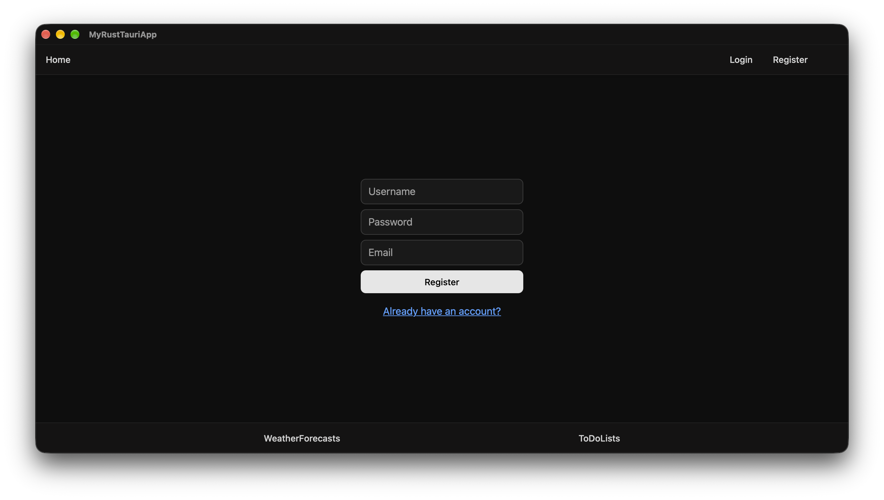
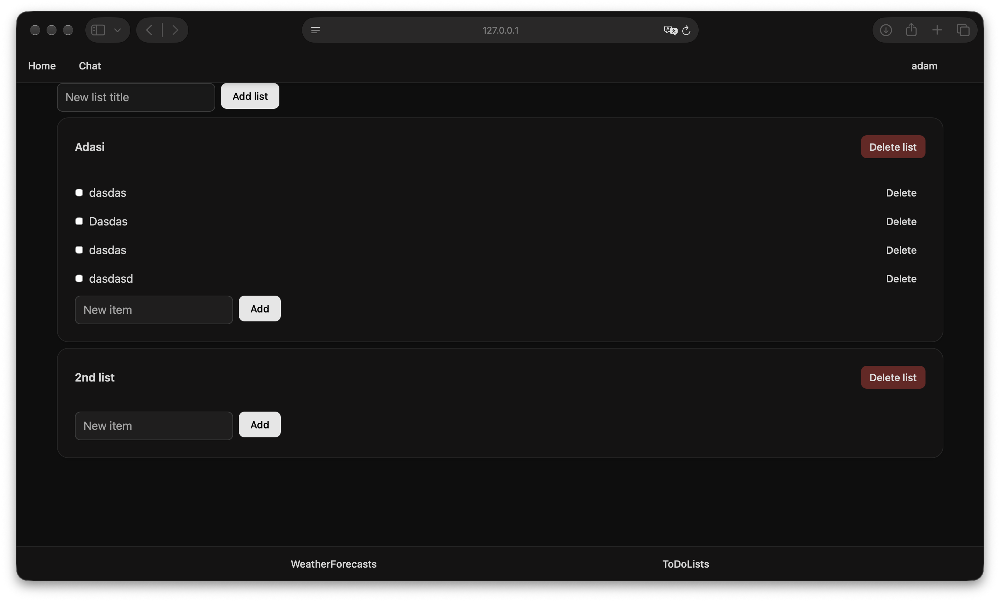

# Rust Project Template

Refactored and modified [full stack rust template](https://github.com/sollambert/rust-full-stack-with-auth-template) 

Built using:
- Dioxus, with [Dioxus components](https://github.com/DioxusLabs/components) (shadcn-style UI)
- Tailwinds (v4)
- Axum
- Sqlx
- Utoipa
- Tauri

This project is built to make full stack development with user authentication easily accessible for developers within an entirely Rust ecosystem.

## Web API and UI for:
- register, login user
- ToDos user lists with ToDos items
- fake random, WeatherForecasts

Authentication/authorization is achieved with JSON Web Tokens. 
This is achieved in a two-part authentication process that involves the user signing in/creating an account at which point they are issued an authentication token for a defined amount of time.

With this token, users are then able to request authorization tokens to perform authorized actions depending on access level. 
Through frontend middleware, this process is handled automatically and the authorization token is placed into request headers as a Bearer auth token whenever a request is sent to the backend.

Web socket authentication functions slightly differently, as the authentication handshake occurs through the first message of a freshly opened websocket instead of being sent as a Bearer auth header.

The specific flavor of SQL (Postgres or SQLite) is inferred from the `DATABASE_URL` environment variable.

## Crates

- `frontend`: Dioxus frontend app for desktop client, built with the `dx` CLI.
- `backend`: Axum backend restful and websocket api for desktop client.
- `server`: Axum server side restful and websocket api (presentation layer and composition root).
- `domain`: Entities, business rules and repository interfaces of the server. No framework dependencies.
- `application`: Use cases of the server and the ports (interfaces) they need, e.g. password hashing, tokens, mail.
- `infrastructure`: Implementations of those ports: sqlx repositories, bcrypt, JWT, SMTP, in-memory stores.
- `types`: Common types shared by frontend/backend/server (the API contract).
- `tauri`: Tauri app for desktop client.

### Server architecture

The server follows Clean Architecture. Dependencies only point inwards, and the compiler enforces it because each layer is its own crate:

```
server (axum controllers, composition root) ──┬──> application ──> domain <── infrastructure (sqlx, bcrypt, JWT, SMTP)
                                              └─────────────────────────────────────────────^
                                                  (only `bootstrap` wires infrastructure in)
```

- Controllers extract the request, call a use case on `application` and map the result to a response.
- Use cases (`AuthService`, `UserService`, `TodoService`, `WeatherService`) depend on traits, so they are unit tested with in-memory fakes and need no database.
- `server::bootstrap` is the only place that knows the concrete implementations. Add a feature by defining its entity and repository trait in `domain`, the use case in `application`, the SQL in `infrastructure` and the route in `server`.

## Development

Install

```bash
rustup target add wasm32-unknown-unknown
cargo install dioxus-cli --locked   # `dx`; on macOS needs OpenSSL (brew install openssl@3)
cargo install tauri-cli
cargo install sqlx-cli
```

Run desktop client app

```bash
cargo tauri dev
```



Run server side

```bash
cargo run --bin server
```

Bundle desktop client app

```bash
cargo tauri build
```


Run web frontend
```bash
cd crates/frontend
dx serve --platform web
```



`dx` also builds the Tailwind CSS into `crates/frontend/assets/tailwind.css` (gitignored). Run `dx build` or
`dx serve` once before a plain `cargo check -p frontend`, otherwise the `asset!` macro fails because the file
is missing. CI builds it with the standalone Tailwind CLI.

## UI components

The UI uses shadcn-style components from [DioxusLabs/components](https://github.com/DioxusLabs/components)
(`button`, `input`, `card`, `badge`), copied into `crates/frontend/src/components/<name>/` and built on the
unstyled `dioxus-primitives` crate. They are styled with plain CSS and the theme variables in
`crates/frontend/assets/dx-components-theme.css` (light/dark follows the system setting); Tailwind is used
for layout.

```bash
cd crates/frontend
dx components list          # available components
dx components add dialog    # copy a component into src/components/ and add `pub mod dialog;`
dx components update        # refresh the registry
```

Notes:
- The components load their CSS through Dioxus assets, so the frontend must be built with `dx`, not Trunk.
- A component's `class` attribute can replace its own styling, so use `style` or a wrapper element for
  layout tweaks.

Run migrations (creates the database first if it does not exist)
```bash
# Postgres
scripts/migrate.sh postgres
# SQLite
sqlx database create 
scripts/migrate.sh sqlite
```

API documentation (OpenAPI 3.2)

The server generates an OpenAPI 3.2 document from the `#[utoipa::path]` annotations on the handlers and the
`ToSchema` derives on the shared types. While the server is running:
- `http://localhost:3001/api-docs/openapi.json` serves the document
- `http://localhost:3001/api-docs` serves a Swagger UI page (loads Swagger UI from unpkg)

A copy is committed at `docs/openapi.json`. Regenerate it after changing any endpoint or type
(a test fails if it is stale):
```bash
cargo run -q --bin openapi > docs/openapi.json
```

Run the API tests
```bash
# Needs Postgres (docker compose up -d) with migrations applied (scripts/migrate.sh postgres).
# Uses TEST_DATABASE_URL, falling back to DATABASE_URL from the environment or .env.
# The test is skipped if neither is set. Test users are created with unique names and removed afterwards.
cargo test -p server
```

Revert migrations
```bash
# Postgres
sqlx migrate revert --source migrations/postgres
# SQLite
sqlx migrate revert --source migrations/sqlite
```

## Environment Variables

Required environment variables, these can be stored in a .env file at the top level of the repository if not set as OS environment variables are in .env.example file.
Copy as .env file and modify as you need.

## Contribute
    
Feel free to take a look at the current issues in this repo for anything that currently needs to be worked on.

You are also welcome to open a PR or a new issue if you see something is missing or could be improved upon.

## License

MIT
